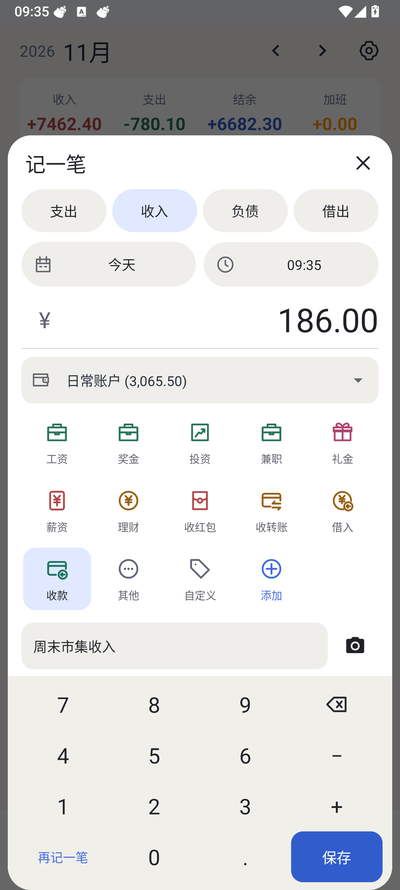
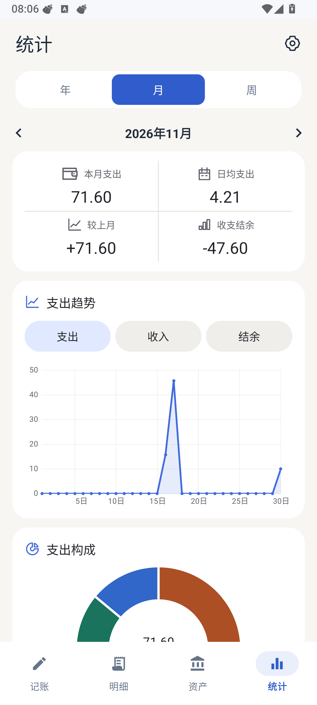
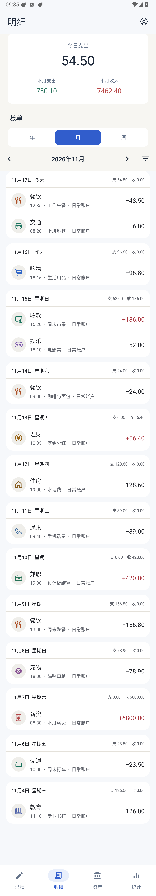

# Tally · 3.8.9-rc2

[](https://github.com/SerendipityR-2022/Tally/actions/workflows/android.yml) [下载正式 APK](https://github.com/SerendipityR-2022/Tally/releases/latest)

> [!IMPORTANT]
> **这是一个纯 Vibe Coding 的个人分支。** 我做这个分支是为了满足个人需求，让 Tally 更符合我的审美和使用习惯。我没有移动应用开发经验，可能无法回复或处理 Issue，还请见谅。

这是柏芸的 [Tally 3.8.5](https://github.com/cypressincloud/Tally/releases/tag/3.8.5) 的个人分支，保留原版账本、预算、资产、续费提醒、多币种、照片备份和 WebDAV 等功能。应用包名为 `com.example.budgetapp`。[稳定版 3.8.8](https://github.com/SerendipityR-2022/Tally/releases/tag/3.8.8)

分支 APK 使用分支签名。如果手机上的同包名版本采用不同签名，需先备份账本再换装。

3.8.8 增加学习记录管理、按应用默认关联资产和动态日均预算，统一了收支构成图，并改进趋势图拖动和微信支付分类。此版还修复了 AI 配置恢复、视觉模型连接测试，以及新增或编辑账单时日期未随选择更新的问题。

[预发布版 3.8.9-rc1](https://github.com/SerendipityR-2022/Tally/releases/tag/3.8.9-rc1) 支持识别已支付的微信群收款，修复部分微信扫码付款详情的收款人提取和 AI 分类，并可在记账助手中开启结果通知。无障碍和实验模式均支持调试采集；应用选择可搜索名称或包名，导出的 XML 带时间戳。

[预发布版 3.8.9-rc2](https://github.com/SerendipityR-2022/Tally/releases/tag/3.8.9-rc2) 新增 6×2「周记账统计」桌面组件；统计页的周支出对比按完整日期区间显示。

## 分支改动

- **自动记账**：保留原生无障碍，新增 Shizuku 实验模式和免确认入账，并扩展原版的 Shizuku 保活以支持实验模式。自动记账调试可采集并导出页面节点和日志，在测试账本回放规则。支付宝规则优先读取明确的收款方，支持转账成功页和脱敏收款人。Release 提供独立的模拟支付 DEMO。
- **分类与 AI**：自动记账优先使用确认学习记录；识别到商户且未命中学习时，才调用已启用的 AI 分类，超时后按本地规则回退。已识别的账单在退出支付页后继续分类。开启反向学习后，确认账单分类或在明细中修改自动账单的分类时，会记住已识别商户的分类；免确认入账本身不会新增学习记录。超时可设为 1–10 秒，最多保留 2000 条学习记录。AI 设置支持获取和选择服务端模型。
- **数据恢复**：本地 ZIP 合并导入会恢复备份中已有的储蓄目标、周期记账规则和资产关联，支持原版 3.8.5 的备份；重复导入同一备份不会增加相同记录。
- **动态日均预算**：在预算管理中开启后，记账页按当天以前的支出调整当日额度。记账页的未来额度和预算页的「明日起日均」使用同一个预测值：预留本月已录入的未来支出及未生效的周期账单后，再平分余额。未来日期的进度条显示「当天预留金额 / 日额度」。
- **预算历史**：使用各月保存的预算额度，排除不计入预算的账单和资产互转，结余与预算页采用相同口径。旧月份若没有保存过额度，历史会明确标注。
- **收入分类**：新增薪资、理财、收红包、收转账、借入、收款、其他及相应图标，保留原有分类和自定义图标。
- **界面**：改进日历、记账表单、明细、预算和资产总览，设置支持搜索。统计概览四等分，支出对比随年、月、周切换。趋势图可点击数据点保留金额标签，或在图表内直接横滑切换数据点。确认窗中的备注输入会随键盘上移。

## 屏幕自动记账

在 **设置 → 记账助手** 选择一种方式，自动记账默认关闭：

- **原生无障碍**：在系统设置开启「记账屏幕同步助手」，然后开启屏幕自动记账。
- **Shizuku 实验模式**：启动 Shizuku（API 13 或更高）并授权 Tally，再开启实验模式和屏幕自动记账。该模式需要通知权限；弹出确认窗时还需悬浮窗权限。锁屏或熄屏时暂停读取。

只对支持或配置的支付页面做常规识别；不会截图。正常自动记账不保存页面原始树。调试采集和导出由用户主动发起。

### Shizuku 实验模式的限制

实验模式最初是为了解决部分厂商对原生无障碍服务的限制，后续也对读屏性能做了优化，但仍有兼容性限制。

- **微信节点混淆**：仅使用 Shizuku 实验模式，目前无法解决微信对返回节点的混淆。可以在保留 Tally 实验模式的同时，开启 GKD 的「无障碍模式」。实测这样可让微信暂时停止混淆、返回可读取的节点，效果可能因系统和微信版本而异。也可以直接将 Tally 切换到原生无障碍模式。
- **读屏连接冲突**：其他同样通过 Shell 调用 `UiAutomation` 的工具可能与 Tally 争用连接，例如 GKD 的「自动化模式」。如果实验模式提示连接失败或读不到节点，先关闭 GKD 的「自动化模式」或其他同类服务，再重试。

## 基准：与原版对照

各列采用该模式最近一次实测：原版沿用原生无障碍对照，分支采用 **2026 年 11 月 17 日**的 Shizuku 伴生测试。测试运行于 Android 14 模拟器，使用合成支付页；各批次结果只作参考。CPU 数值为应用进程及其读屏相关进程的 CPU 时间（ms/s），不是耗电量。

| 场景 / 指标 | 原版 · 原生无障碍<br>2026-11-16 | 本分支 · Shizuku 实验模式<br>2026-11-17 |
| --- | ---: | ---: |
| 亮屏桌面 CPU | 0.4954 | 0.0362 |
| 静态支付页 CPU | 0.0174 | 0.3128 |
| 熄屏 CPU | 0.0000 | 0.0138 |
| 支付页每 50 ms 刷新 CPU | 2.8215 | 11.6414 |
| 应用内切入支付页，确认窗中位耗时 | 601.54 ms；12/12 | 138.19 ms；12/12 |
| 从桌面切入支付页，确认窗中位耗时 | 543.34 ms；12/12 | 141.80 ms；12/12 |
| 应用内 550 ms 短页，确认窗中位耗时 | 599.80 ms；12/12 | 135.56 ms；12/12 |

<details>
<summary>软件截图（展开查看）</summary>

截图来自模拟器上的 Tally 3.8.8-rc4，账单均为示例数据。点击图片可查看原图。

| 记一笔 | 统计（长图） | 明细（长图） |
| :---: | :---: | :---: |
| [](.github/screenshots/record.png) | [](.github/screenshots/stats.png) | [](.github/screenshots/details.png) |

</details>

<details>
<summary>WebDAV、AI 记账与隐私</summary>

- **本地迁移**：先从原版导出 ZIP 并存到下载目录或电脑。安装分支后，到「设置 → 导入与导出 → 导入数据 (Zip)」恢复。旧备份中的照片只有路径，照片文件需要单独保留。
- **云备份**：在「设置 → 云备份」配置 WebDAV 地址、用户名和密码，验证连接后可以手动备份或开启自动同步。恢复会覆盖本地数据。
- **AI 记账**：在「设置 → AI 记账配置」填写兼容 OpenAI 的服务地址和 API Key，选择模型并测试连接。按模型支持情况录入文字、图片或语音。
- 账本数据默认保存在本地。WebDAV 与 AI 功能需要主动配置，分别使用你选择的备份服务和模型服务。

</details>

## 构建

需 JDK 21 和 Android SDK 36。GitHub Actions 在 `master` 提交及 PR 上运行单元测试，构建未签名的 Tally 和模拟支付 DEMO；可在 Actions 下载构建产物。可安装的签名 APK 见 Releases。

```bash
./gradlew -PtallyUnsignedCiBuild=true :app:testDebugUnitTest :app:testReleaseUnitTest :app:assembleRelease :payment-demo:assembleRelease
```

感谢原作者柏芸（[cypressincloud](https://github.com/cypressincloud)）。本分支的问题可在 [Issues](https://github.com/SerendipityR-2022/Tally/issues) 反馈。
