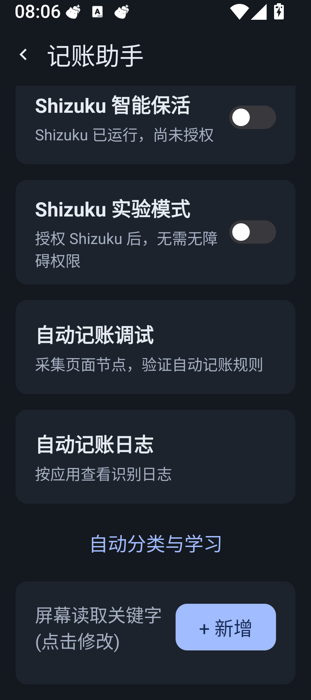
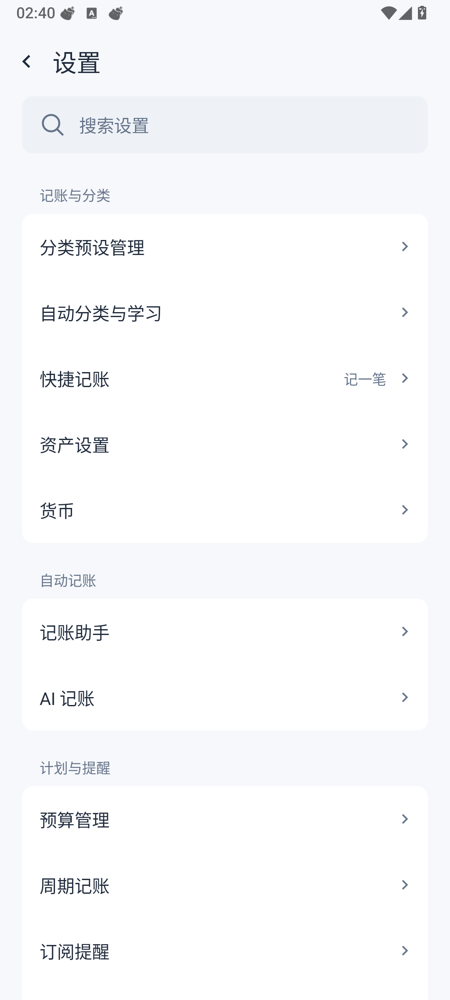

# Tally · 3.8.5-based

[](https://github.com/SerendipityR-2022/Tally/actions/workflows/android.yml) [下载正式 APK](https://github.com/SerendipityR-2022/Tally/releases/latest)

这是柏芸的 [Tally 3.8.5](https://github.com/cypressincloud/Tally/releases/tag/3.8.5) 的社区分支，保留原版账本、预算、资产、续费提醒、多币种、照片备份和 WebDAV 等功能。版本名为 `3.8.5-based`，应用包名为 `com.example.budgetapp`。[本次完整改动](https://github.com/SerendipityR-2022/Tally/releases/tag/3.8.5-based)

分支 APK 使用分支签名。如果手机上的同包名版本采用不同签名，需先备份账本再换装。

## 分支改动

- **自动记账**：保留原生无障碍，新增 Shizuku 实验模式和免确认入账，并扩展原版的 Shizuku 保活以支持实验模式。自动记账调试可采集并导出页面节点和日志，在测试账本回放规则。Release 提供独立的模拟支付 DEMO。
- **分类与 AI**：自动记账共用分类规则、关键词和确认学习。启用 AI 分类时，有效模型结果优先，超时按本地规则回退；可设置 1–10 秒超时，最多保留 2000 条确认学习记录。AI 设置支持获取和选择服务端模型。
- **界面**：改进日历、记账表单、明细、预算和资产总览，设置支持搜索。统计概览四等分，周、月、年趋势均显示数据点。确认窗中的备注输入会随键盘上移。

## 屏幕自动记账

在 **设置 → 记账助手** 选择一种方式，自动记账默认关闭：

- **原生无障碍**：在系统设置开启「记账屏幕同步助手」，然后开启屏幕自动记账。
- **Shizuku 实验模式**：启动 Shizuku（API 13 或更高）并授权 Tally，再开启实验模式和屏幕自动记账。该模式需要通知权限；弹出确认窗时还需悬浮窗权限。锁屏或熄屏时暂停读取。

只对支持或配置的支付页面做常规识别；不会截图。正常自动记账不保存页面原始树。调试采集和导出由用户主动发起。

### Shizuku 实验模式的限制

实验模式最初是为了解决部分厂商对原生无障碍服务的限制，后续也对读屏性能做了优化，但仍有兼容性限制。

- **微信节点混淆**：仅使用 Shizuku 实验模式，目前无法解决微信对返回节点的混淆。可以在保留 Tally 实验模式的同时，开启 GKD 的「无障碍模式」。实测这样可让微信暂时停止混淆、返回可读取的节点，效果可能因系统和微信版本而异。也可以直接将 Tally 切换到原生无障碍模式。
- **读屏连接冲突**：其他同样通过 Shell 调用 `UiAutomation` 的工具可能与 Tally 争用连接，例如 GKD 的「自动化模式」。如果实验模式提示连接失败或读不到节点，先关闭 GKD 的「自动化模式」或其他同类服务，再重试。

## 基准：与原版对照

各列采用该模式最近一次实测：原版沿用原生无障碍对照，分支采用 **2026 年 11 月 17 日**的 Shizuku 伴生测试。测试运行于 Android 14 模拟器，使用合成支付页；各批次结果只作参考。CPU 数值为应用进程及其读屏相关进程的 CPU 时间（ms/s），不是耗电量。

| 场景 / 指标 | 原版 · 原生无障碍<br>2026-11-16 | 本分支 · Shizuku 实验模式<br>2026-11-17 |
| --- | ---: | ---: |
| 亮屏桌面 CPU | 0.4954 | 0.0362 |
| 静态支付页 CPU | 0.0174 | 0.3128 |
| 熄屏 CPU | 0.0000 | 0.0138 |
| 支付页每 50 ms 刷新 CPU | 2.8215 | 11.6414 |
| 应用内切入支付页，确认窗中位耗时 | 601.54 ms；12/12 | 138.19 ms；12/12 |
| 从桌面切入支付页，确认窗中位耗时 | 543.34 ms；12/12 | 141.80 ms；12/12 |
| 应用内 550 ms 短页，确认窗中位耗时 | 599.80 ms；12/12 | 135.56 ms；12/12 |

<details>
<summary>软件截图（展开查看）</summary>

 

 

</details>

<details>
<summary>WebDAV、AI 记账与隐私</summary>

- **云备份**：在「设置 → 云备份」配置 WebDAV 地址、用户名和密码，验证连接后可以手动备份或开启自动同步。恢复会覆盖本地数据。
- **AI 记账**：在「设置 → AI 记账配置」填写兼容 OpenAI 的服务地址和 API Key，选择模型并测试连接。按模型支持情况录入文字、图片或语音。
- 账本数据默认保存在本地。WebDAV 与 AI 功能需要主动配置，分别使用你选择的备份服务和模型服务。

</details>

## 构建

需 JDK 21 和 Android SDK 36。GitHub Actions 在 `master` 提交及 PR 上运行单元测试，构建未签名的 Tally 和模拟支付 DEMO；可在 Actions 下载构建产物。可安装的签名 APK 见 Releases。

```bash
./gradlew -PtallyUnsignedCiBuild=true :app:testDebugUnitTest :app:testReleaseUnitTest :app:assembleRelease :payment-demo:assembleRelease
```

感谢原作者柏芸（[cypressincloud](https://github.com/cypressincloud)）。本分支问题请在 [Issues](https://github.com/SerendipityR-2022/Tally/issues) 反馈。
